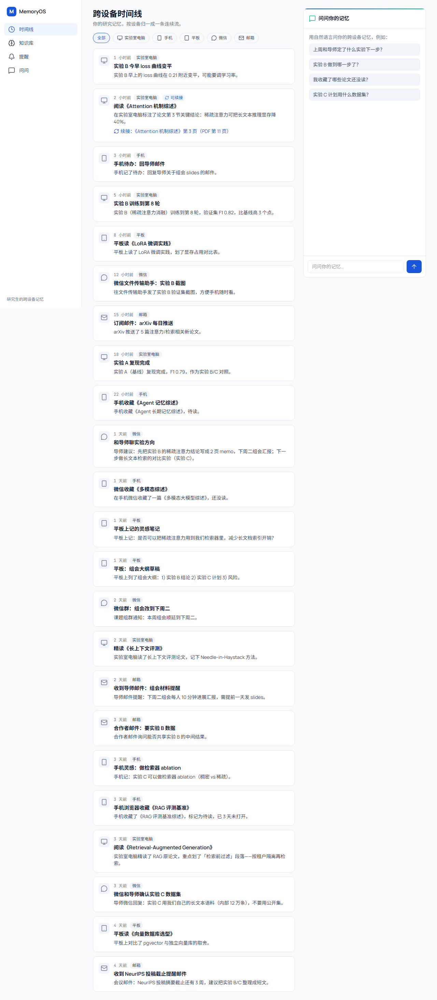
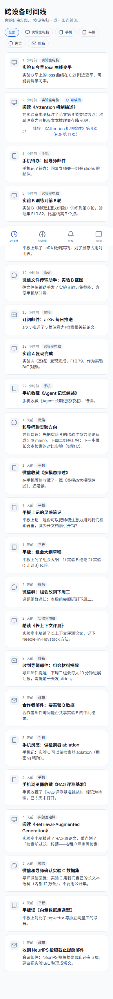
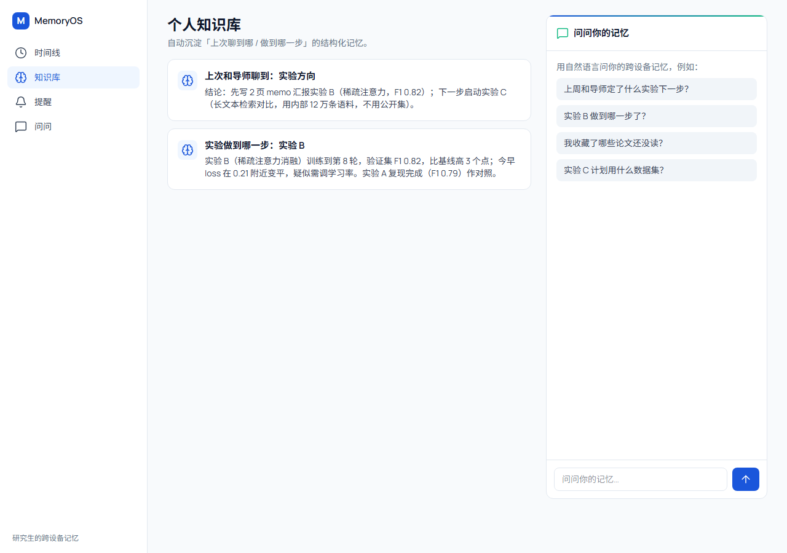
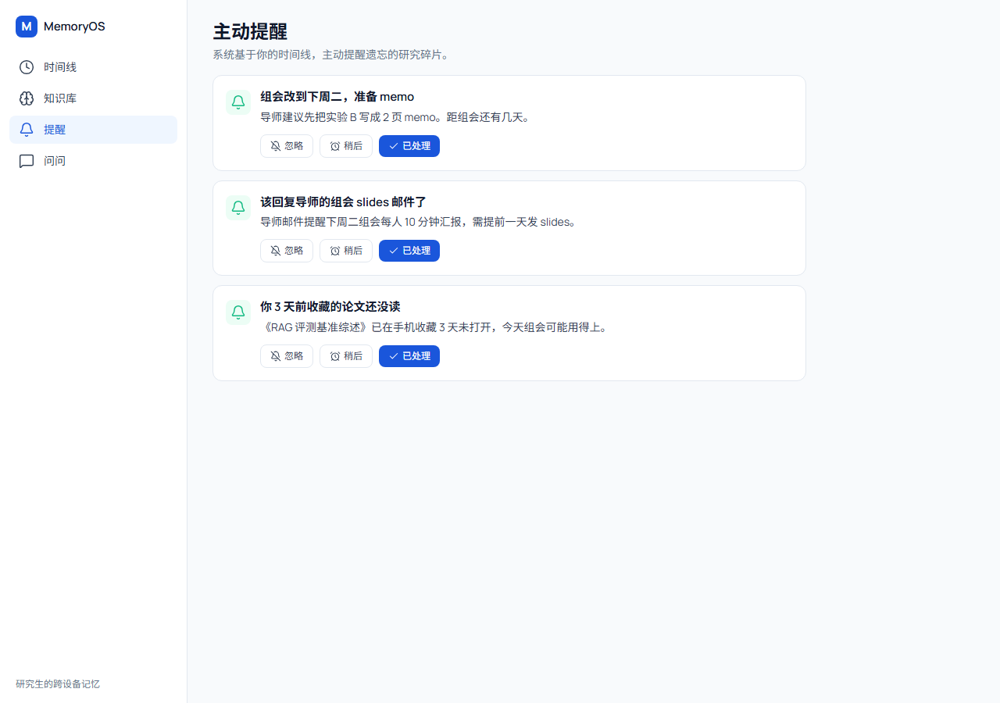
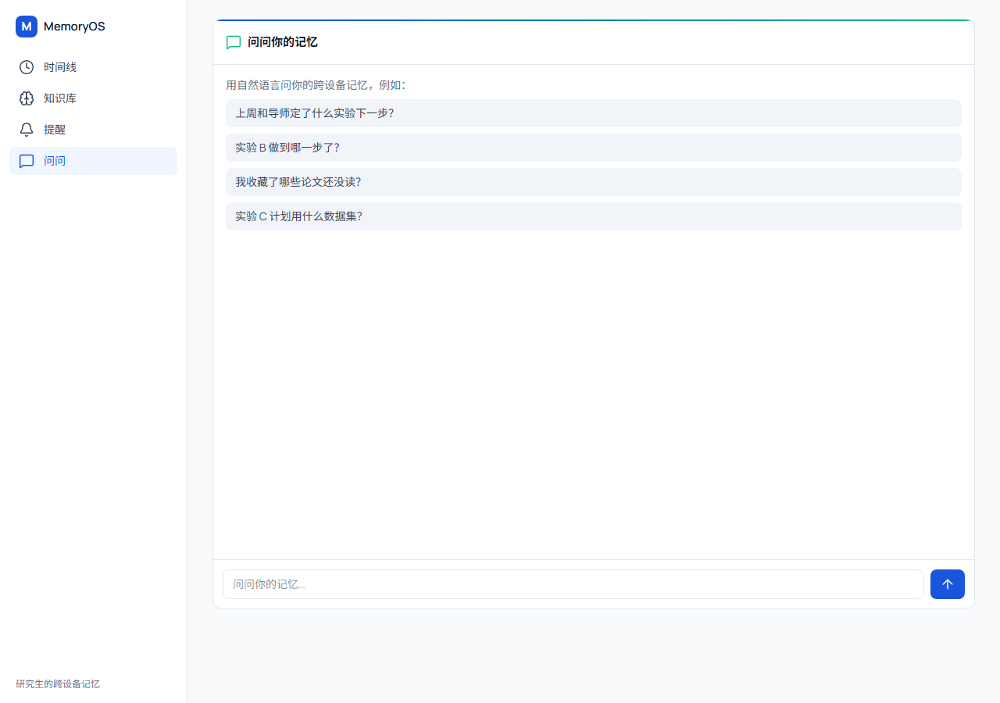

# MemoryOS · 跨设备个人记忆型 Agent

> 研究生的「第二大脑」：把实验室电脑、手机、平板、微信、邮箱里碎片化的研究上下文，汇聚成一条统一时间线 + 个人知识库 + 主动提醒。




---

## 关于这个项目（产品视角）

研究生在实验室电脑、个人手机、平板、微信、邮箱之间反复切换，信息高度碎片化，经常"记不住上次和导师聊到哪、实验做到哪一步"。MemoryOS 想解决的就是这件事：**让个人上下文跨设备连续，并主动帮你想起该做的事**。

这是一个**端到端走通的产品 MVP**：从问题定义、竞品分析、优先级排序，到架构设计、UI/UX 设计系统，再到可运行的 Web 应用，全流程文档与代码都在本仓库里。

## 我的角色与产出

> 本项目由产品侧主导定义与交付（AI 辅助实现）。仓库内保留了完整的产品痕迹，便于复盘与展示：

| 产物 | 文件 | 说明 |
|------|------|------|
| 产品需求文档 PRD | `MemoryOS_PRD.md` | 用户画像、竞品（6 直接 + 2 替代）、RICE 排序、用户故事、验收标准 |
| 架构设计 Spec | `architecture-spec-memoryos.md` | 技术对比矩阵、API 端点、数据表、风险 |
| UI/UX 设计系统 | `DESIGN.md` + `design-system/` | Design Token、页面规范、对标品牌 |
| 规格契约 Spec | `MemoryOS_SPEC.md` | 范围 / Out-of-Scope / 技术架构 / 验收标准 |
| 可运行 MVP | `app/` `components/` `lib/` | Next.js 应用，四页面 + 11 个 API |

## 核心能力（三大件）

1. **跨设备统一时间线**：五类设备源（实验室电脑 / 手机 / 平板 / 微信 / 邮箱）事件归一为一条时间线，支持按设备筛选、断点「可续接」标记。
2. **个人知识库自然语言问答**：基于个人知识库检索并**附可点击引用**（跳转原始事件），接云端大模型即真问真答。
3. **主动提醒卡片**：基于时间线规则生成「3 天前收藏未读」「该回导师邮件」等提醒，支持忽略 / 稍后 / 已处理。
4. **自动记忆卡 / 跨设备续接**：把「与导师同步 / 实验进展」沉淀为结构化记忆，可问答检索；在任意设备从断点继续。

## 真实能力 vs 演示态（如实说明）

为了让评审一眼看懂边界，这里明确标注：

| 能力 | 状态 | 说明 |
|------|------|------|
| 时间线 / 提醒 / 记忆卡 / 问答 UI 与交互 | ✅ 真实可用 | 完整前端交互闭环 |
| 设备数据 | 🟡 模拟事件流 | 来自 `lib/seed.ts` 的演示数据，非真实微信/邮箱 API 集成 |
| 知识库问答 | 🟢 双模式 | 未接大模型时走**演示检索回答**（标注"演示模式"）；配置 `CLOUDBASE_AI_GATEWAY` 后走真实云端模型 |
| 多租户 / 生产数据库 | ⚪ 未实现 | MVP 用内存数据层，生产替换为 CloudBase PostgreSQL + pgvector |

> 定位：这是一个**可演示的 MVP**，用于呈现完整体验与产品决策；生产环境会接入真实设备 API 与云端大模型。

## 技术栈

Next.js 16 (App Router) · React 19 · Tailwind CSS v4 · lucide-react · SWR · TypeScript

设计遵循：统一 SVG 图标库（Lucide，禁 emoji 图标）、零硬编码色（全走 Design Token）、禁紫粉渐变、禁 AI 模板味。

## 快速开始

```bash
npm install
npm run dev          # 访问 http://localhost:3000
# 或生产模式
npm run build && npm run start
```

接入真实大模型（可选，无需改代码）：

```bash
CLOUDBASE_AI_GATEWAY=https://<你的网关地址>   CLOUDBASE_AI_MODEL=deepseek-v3   npm run dev
```

## 界面预览

| 页面 | 截图 |
|------|------|
| 跨设备时间线（桌面） |  |
| 个人知识库 |  |
| 主动提醒 |  |
| 自然语言问答 |  |
| 移动端时间线（底部 TabBar 响应式） |  |

## 部署（Vercel 一键上线）

Next.js 项目可直接部署到 [Vercel](https://vercel.com)：

1. 推送到 GitHub 后，在 Vercel 导入该仓库（框架会自动识别为 Next.js）；
2. 或直接本地执行 `npx vercel` 并按提示登录部署；
3. 演示模式无需任何环境变量即可公开访问；想接真实问答，在 Vercel 项目环境变量中加入 `CLOUDBASE_AI_GATEWAY` 与 `CLOUDBASE_AI_MODEL`。

## 目录结构

```
app/            路由与页面（时间线 / 知识库 / 提醒 / 问答 + 11 个 API）
components/      UI 组件（导航、时间线项、提醒卡、记忆卡、问答面板、状态页）
lib/            数据层(seed/store) + LLM 适配层 + 类型
design-system/  Design Token 与设计规范
*.md            产品 / 架构 / 设计 / Spec 文档
```

## 许可证

[MIT](LICENSE) — 发布前请把版权署名改为你自己的名字。
